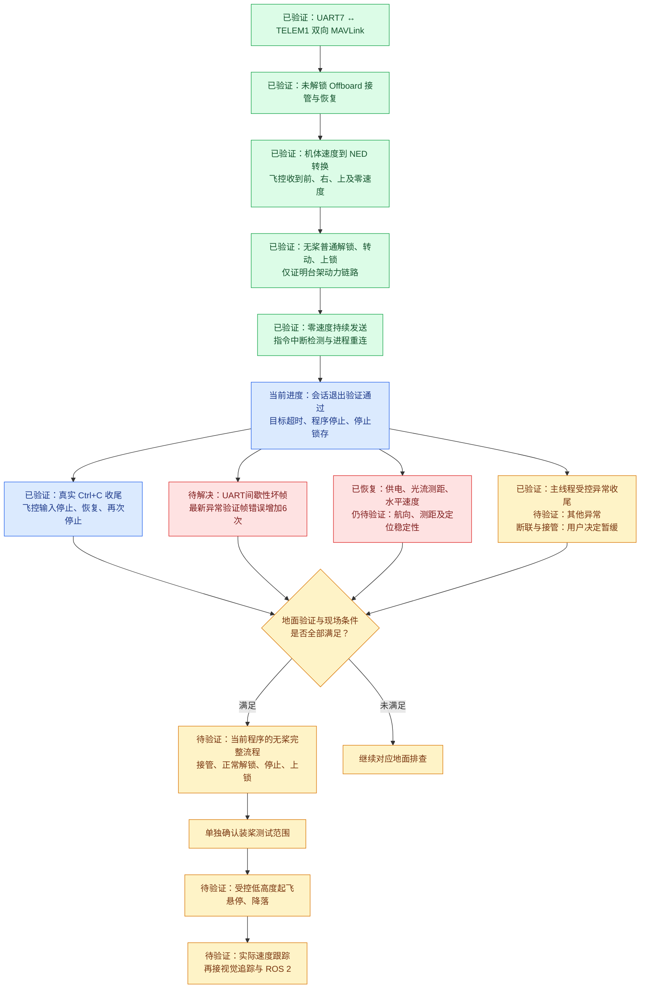

更新：2026-10-09。项目：`/home/pi/drone_project`；视觉代码：`/home/pi/cv_work`。
当前结论：**未解锁Offboard接管、Ctrl+C及主线程受控异常收尾已验证；充电后光流/测距和水平估计恢复。最新测试UART帧错误增加6次，通信问题仍在；遥控接管、航向与飞行保护待验证，尚未完成飞行验证。**

## 验证流程图

绿色：已实测通过；蓝色：当前进度；红色：未解决问题；黄色：待验证。箭头表示推进条件，不表示后续步骤已获执行授权。

## 已验证项目与证据

- [x] 双向MAVLink：参数回复与固件信息请求ACK=0，目标System ID=1、Component ID=1。
- [x] Offboard接管：ACK=0，并由心跳确认模式；完成后恢复未解锁LOITER。
- [x] 设定值接收：读取飞控trajectory_setpoint，确认机体前/右速度转换为NED，以及向上和回零目标。仅证明指令接收与转换，不证明真实飞行跟踪。
- [x] 无桨动力链路：曾正常解锁约1秒、上锁，用户确认电机转动并完全停转；无强制解锁。
- [x] 零速度连续发送约60秒；失联标志False→True→False；测试进程退出后UART释放、新进程重连成功。不是实际飞行失联动作验证。
- [x] 最新会话验证：目标0.5秒过期和程序人工停止后，发送线程结束，拒绝新目标自动激活；两轮恢复ACK=0，心跳确认未解锁LOITER。
- [x] 心跳中断与意外解锁停止条件仅完成离线测试，未在实机制造这两种故障。

## 待解决问题

- [ ] **通信可靠性**：历史UART坏帧根因未知。最新验证内核fe=483→498（增加15）、brk=34不变；重连阶段7条Bad prefix，独立输入时序检查3条Bad prefix，不可统称CRC错误。USB对照曾无CRC，排查范围仍为TELEM1、线缆/电气条件、板端UART7硬件或驱动。
- [x] **供电与水平估计恢复**：充电恢复后约16.87V、warning=0，光流/测距新鲜，xy_valid=True、v_xy_valid=True、dead_reckoning=False、local_velocity_invalid=False。
- [ ] **定位适用性**：heading_good_for_control=False、dist_bottom_valid=False、地面水平reset频繁；需要进一步核实航向、测距及长期定位稳定性，当前有效不等于飞行稳定。
- [x] **Ctrl+C退出与输入时序**：真实控制终端触发SIGINT，finally恢复ACK=0、未解锁LOITER，退出码130；Offboard输入停止更新，新零速度输入更新，停止后再次固定。仅为采样证据，不是精确毫秒级延迟测量。
- [x] **受控异常收尾**：ACTIVE主线程主动RuntimeError后停止发送、恢复ACK=0、未解锁LOITER、预期退出码2；新连接输入固定，无自动重放。
- [ ] **其他异常退出**：发送线程故障、连续中断等其他异常，以及飞行中的保护响应仍待验证。
- [ ] **接管和保护（暂缓）**：已完成当前参数只读核对；用户决定暂不处理断联与接管，后续再解决。参数未改，实际响应未验证。
- [ ] **当前程序完整无桨流程**：接管、正常解锁、停止、上锁以及最终状态确认，动力测试前重新确认现场无桨。
- [ ] **装桨验证**：单独确认范围后，分步验证受控低高度起飞、悬停、降落与实际速度跟踪。

## 当前接口与边界

Orange Pi UART7 `/dev/ttyS7`、115200、8N1 ↔ 飞控TELEM1。COM24为飞控USB，COM25为开发板调试端口，**与当前UART7通信链路无关**。
默认`python3 test.py`保持只读监测和视觉预览。前置IMX219、目标追踪、ROS 2可以后置，不要求先完成目标距离估计才能验证基本控制。
最新测试后确认未解锁LOITER，UART7无占用。本文是验证记录，不是飞行许可，不自动执行解锁、装桨或飞行。

## 可复查资料

远端记录：`/home/pi/drone_project/docs/validation_20261009.md`。
未解锁会话脚本：`/home/pi/drone_project/scripts/offboard_session_check.py`。
相关知识页：<mention-page url="https://www.notion.so/3f30556a33d781b293c9c8a1e77ccb94"/>。本记录以实际测试结果为准，旧知识页不作为新的硬件状态证据。
